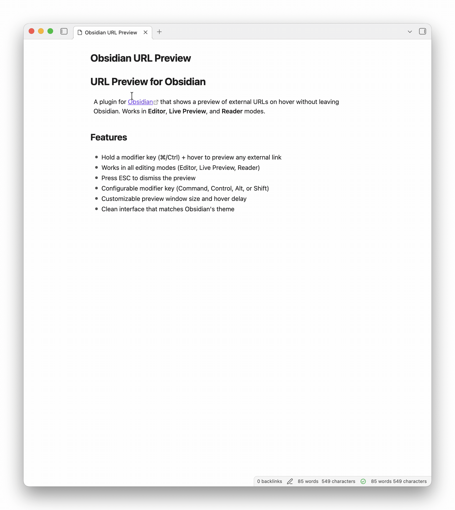

# URL Preview for Obsidian

A plugin for [Obsidian](https://obsidian.md) that shows a preview of external URLs without leaving Obsidian. Works in **Editor**, **Live Preview**, and **Reader** modes.



## Features

- Hold configurable modifier keys (⌘, Control, Alt, or Shift) + click to preview URLs
- Works in all view modes (Editor, Live Preview, Reader)
- Works in secondary Obsidian windows/popouts
- Clean interface that matches Obsidian's theme
- Press ESC to dismiss the preview window
- Customize preview window size
- Resize preview window by dragging edges or corners
  - Toolbar button to quickly expand or restore the preview size
  - Accent-colored border highlight on resize handle hover (uses Obsidian's accent color)
  - Live size indicator showing dimensions during resize
  - Optionally persist resized dimensions across previews
- Preview controls live in a toolbar above the content, with back/forward navigation and an editable address bar
- Open one reusable right-side panel inside the current page, keeping your note on the left
- Keep up to five recent previews in memory for immediate reopening with their scroll position preserved
- Optionally show a small eye button beside hovered links to open the preview directly
- Bare GitHub URLs and short references such as `owner/repo#123` show a GitHub button to convert them to Markdown links
- Toolbar zoom controls remember zoom per domain
- Toolbar buttons show bottom-positioned action tooltips
- Sign in and out using the website's own controls inside the preview
- Right-click an editor URL to convert it to a Markdown link using the page title

## Installation

1. Open Obsidian Settings
2. Go to Community Plugins and disable Safe Mode
3. Click Browse and search for "URL Preview"
4. Install the plugin and enable it

## Settings

- **Preview click modifiers**: which keys to hold while clicking a link (Command, Control, Option, Shift — combine as many as you like)
- **Sticky popup**: keep the preview open until Escape or a click outside
- **Show open in browser button**: show a button that opens the URL in your default browser
- **Show close button**: show a button that closes the preview
- **Show loading indicators**: show the initial loading overlay and the spinners (off by default); turning it off also drops the content-area background override
- **Show preview button on link hover**: show the eye button beside hovered links (off on new installs)
- **Show external-link icon**: keep Obsidian's external-link glyph beside links
- **Show GitHub hover cards**: show a card with the title and state when hovering a GitHub issue or pull request with your modifier keys held
- **Show GitHub issue and PR numbers**: show `#123` beside GitHub issue and pull request links
- **Maximum height / width**: maximum size of the preview window, in pixels
- **Allow resize**: drag the preview's edges and corners to resize it
- **Persist resize**: reuse the resized dimensions for later previews, with a reset button

## Usage

Hold your configured modifier keys (⌘ on Mac, Ctrl on Windows/Linux by default) and click any external link to see a preview. Without a mouse, put the cursor on a link and run **URL Preview: Preview link at cursor** from the command palette.

URLs written inside inline code or a fenced code block are left alone: they get no preview and no GitHub badge.

Use **Open in right-side panel** in the toolbar to place the preview beside your note without creating a workspace split or tab. Further preview links reuse that panel; Back and Forward follow both links opened from notes and navigation within the website. Closing the panel restores the note's full width. Closing a preview keeps its loaded page in memory. On reopening, the cached page appears immediately while a fresh copy loads behind it. The replacement preserves page scrolling; failed refreshes and active edits keep the existing page. Refreshes are triggered only by reopening a closed preview. A cached page is silenced while it is out of sight, and is dropped five minutes after you close it, when a sixth page pushes it out, or when the plugin unloads.

The panel docks beside the note or [Kanban](https://github.com/mgmeyers/obsidian-kanban) board the preview was opened from, or beside the most recent one. The side-panel toolbar button switches back to a floating preview without reloading. Drag the divider to resize the note and preview; its position is remembered. The divider highlights in the accent color on hover and while dragging, and supports Left/Right arrow keys when focused.

In Live Preview or source mode, right-click an external URL, a scheme-less `github.com/...` URL, or a short GitHub reference such as `owner/repo#123`, then choose **Convert URL to Markdown link** to replace it with `[page title](url)`. For GitHub pull request and issue links, the menu also includes **Add repo name prefix**, **Copy issue or PR ID**, and **Copy agent session title**.

## API

Other plugins can open a preview through `app.plugins.plugins['url-preview'].api`, present while URL Preview is enabled:

```ts
api.open(url: string, options: { anchor: HTMLElement; side?: boolean }): boolean
```

- `anchor` is the element the preview opens beside, as if a link there had been modifier-clicked. When the side panel is already open beside it, the panel shows the URL.
- `side: true` opens the preview in the side panel straight away.
- It returns `false`, and opens nothing, for a URL that is not `http` or `https`.

## Authentication

On desktop, previews use Obsidian's persistent embedded browser session when available, so login state can be reused by later previews. Use the website's own sign-in and sign-out controls.

## Limitations

On desktop the preview is an embedded browser view, so a site's framing rules do not apply and most pages load.

Where that embedded view is unavailable — on mobile, or in a host without it — the preview falls back to an `iframe`. There, a site that blocks framing cannot be previewed, a blocked page stays blank with no message, and Back and Forward only follow links opened from your notes, not navigation inside the page.

## Credits

The GitHub hover card's loading skeleton is drawn with a two-glyph subset of [Flow Circular](https://github.com/dharmatype/Flow) by Dan Ross, licensed under the [SIL Open Font License 1.1](https://openfontlicense.org/).

## Support

If you encounter issues or have suggestions, please file them on the [GitHub repository](https://github.com/ovitrif/obsidian-url-preview/issues).

## Changelog

See [CHANGELOG.md](CHANGELOG.md) for release history.

## License

MIT. See [LICENSE](LICENSE).
